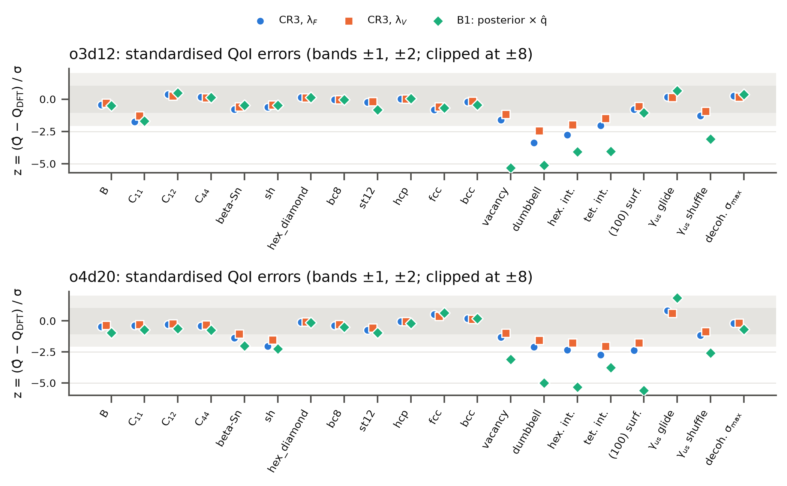
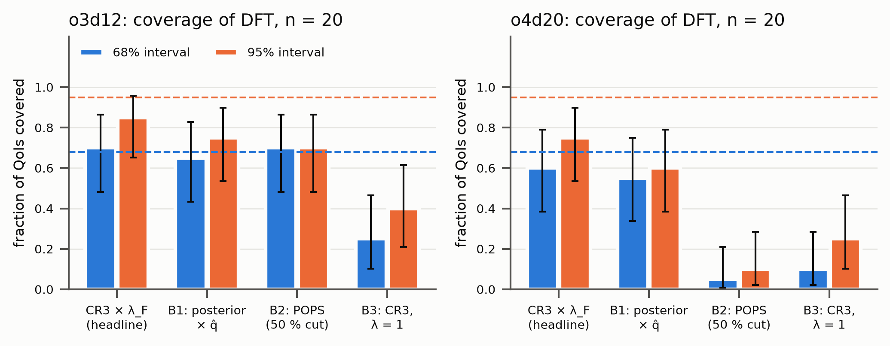
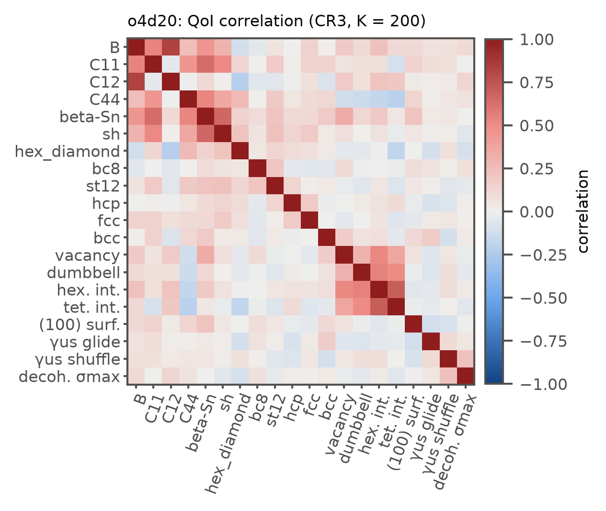
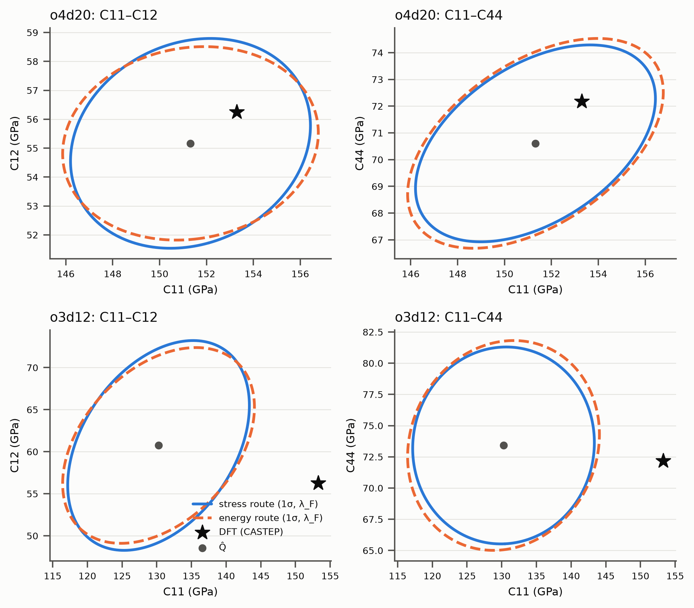
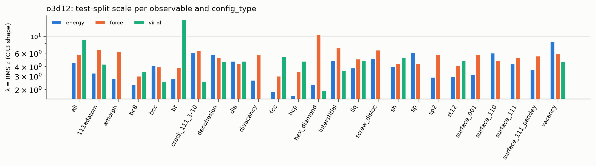

# Silicon QoI uncertainty: calibrated linear-ACE parameter UQ against DFT

Generated by `python -m bench.si_qoi_uq.run --all` from `results/` (git 24f680ea0d, dirty tree). Spec: `docs/dev/specs/2026-10-31-silicon-qoi-uq-propagation.md`; scope decisions: `RECON.md`.

**Headline.** With the CR3 shape scaled by the force-calibrated λ_F (test-split forces only), the intervals cover the DFT value for o3d12: 19/20 at 95 % (CI 0.75–1.00) and 14/20 at 68 % of the coverage QoIs (`coverage.csv`, method CR3-headline, scale lam_F).

**Calibrated on:** the 248-configuration test split's energies, forces and virials (λ_E, λ_F, λ_V, λ_pool; B1's q̂). The fits saw only the 2227 training configurations. **Not calibrated on:** any QoI or DFT QoI value. The QoIs are the validation. The optional section 7 diagnostic was not run.

## Scale diagnostics (test split, CR3 shape; `scale_diagnostics.csv`)

| model | λ_E | λ_F | λ_V | λ_pool | λ_V/λ_F | λ_E/λ_F | 95 % \|z\| F |
|---|---|---|---|---|---|---|---|
| o3d12 | 4.52 | 5.76 | 9.10 | 6.18 | 1.58 | 0.78 | 11.54 |

λ = RMS of z = (y − ŷ)/‖Lᵀb‖ with L = D⁻¹R the CR3 factor. Rows that vanish by site symmetry are dropped (σ below 10⁻³ × the median σ of their kind).

- **o3d12: λ_V/λ_F = 1.58 lies outside [0.8, 1.25]**: the misspecification depends on the observable.
- **o3d12: λ_E/λ_F = 0.78 lies outside [0.8, 1.25]**: the misspecification depends on the observable.

## Coverage of DFT and sharpness (`coverage.csv`)

| model | method | n | 68 %: k [95 % CI] | 95 %: k [95 % CI] | RMS z | median σ/tol |
|---|---|---|---|---|---|---|
| o3d12 | CR3, λ_F | 20 | 14 [0.46, 0.88] | 19 [0.75, 1.00] | 1.03 | 2.85 |
| o3d12 | CR3, λ_V | 20 | 19 [0.75, 1.00] | 19 [0.75, 1.00] | 0.65 | 4.51 |
| o3d12 | CR3, λ_E | 20 | 14 [0.46, 0.88] | 19 [0.75, 1.00] | 1.31 | 2.24 |
| o3d12 | CR3, λ_pool | 20 | 14 [0.46, 0.88] | 19 [0.75, 1.00] | 0.96 | 3.06 |
| o3d12 | CR3 delta only, λ_F | 18 | 13 [0.47, 0.90] | 16 [0.65, 0.99] | 1.16 | 2.06 |
| o3d12 | CR3 committee only, λ_F | 20 | 14 [0.46, 0.88] | 19 [0.75, 1.00] | 1.05 | 2.85 |
| o3d12 | B3: CR3, λ = 1 | 20 | 5 [0.09, 0.49] | 8 [0.19, 0.64] | 5.92 | 0.50 |
| o3d12 | B1: posterior × q̂ | 20 | 13 [0.41, 0.85] | 15 [0.51, 0.91] | 1.89 | 1.58 |

n counts the coverage QoIs with a σ. That is 20, because the phonon RMS has no DFT value (RECON Q2). The delta-only rows also lack γ_us, and any phase whose E(V) argmin is not the V0 point. Intervals are Q̂ ± 1σ and ± 1.96σ. Headline σ: delta where it agrees with the λ = 1 committee to 10 %, else the committee (§4c).

## Joint test (`joint_tests.json`, correlation-scaled, ε = 10⁻³)

| model | method | covariance | n | df | Mahalanobis | χ²₉₅(df) | p |
|---|---|---|---|---|---|---|---|
| o3d12 | CR3/lam_E | committee | 20 | 19 | 56.1 | 30.1 | 1.6e-05 |
| o3d12 | CR3/lam_E | delta | 18 | 17 | 63.5 | 27.6 | 2.7e-07 |
| o3d12 | CR3/lam_F | committee | 20 | 19 | 34.5 | 30.1 | 0.016 |
| o3d12 | CR3/lam_F | delta | 18 | 17 | 39.1 | 27.6 | 0.0017 |
| o3d12 | CR3/lam_V | committee | 20 | 19 | 13.8 | 30.1 | 0.79 |
| o3d12 | CR3/lam_V | delta | 18 | 17 | 15.7 | 27.6 | 0.55 |
| o3d12 | CR3/lam_pool | committee | 20 | 19 | 30.0 | 30.1 | 0.051 |
| o3d12 | CR3/lam_pool | delta | 18 | 17 | 34.0 | 27.6 | 0.0083 |
| o3d12 | B3/lam_1 | committee | 20 | 19 | 1146.7 | 30.1 | 2.4e-231 |
| o3d12 | B3/lam_1 | delta | 18 | 17 | 1299.2 | 27.6 | 7e-266 |
| o3d12 | B1/q_b1 | committee | 20 | 19 | 58.3 | 30.1 | 7.3e-06 |
| o3d12 | B1/q_b1 | delta | 18 | 17 | 46.4 | 27.6 | 0.00015 |

The ε sensitivity (10⁻⁴, 10⁻²) and the absolute-units form are in `joint_tests.json`.

## Delta method against committee (`delta_vs_committee.csv`, λ = 1)

5 of 24 comparisons differ by more than 10 % (the headline uses the committee σ there):

| model | QoI | σ delta | σ committee | ratio | robust σ committee | delta / robust |
|---|---|---|---|---|---|---|
| o3d12 | dE_hex_diamond (meV/at) | 3.8 | 4.88 | 0.78 | 3.936 | 0.96 |
| o3d12 | dE_hcp (meV/at) | 10.1 | 15 | 0.68 | 11.878 | 0.85 |
| o3d12 | dE_bcc (meV/at) | 7.18 | 9.66 | 0.74 | 7.629 | 0.94 |
| o3d12 | dumbbell_interstitial_energy | 0.0712 | 0.126 | 0.56 | 0.067 | 1.06 |
| o3d12 | tetrahedral_interstitial_energy | 0.237 | 0.206 | 1.15 | 0.187 | 1.26 |

Robust σ is half the 16–84 % range. Where delta/robust ≈ 1, the disagreement comes from a tail of members that change basin. It is not curvature in the bulk of the committee.

## Elastic constants: stress and energy routes (CR3, λ_F; `qoi_uq.csv`)

| model | QoI | Q̂ | DFT | σ stress route | σ energy route |
|---|---|---|---|---|---|
| o3d12 | diamond_c11 | 134.6 | 153.3 | 13.59 | 14.45 |
| o3d12 | diamond_c12 | 61.3 | 56.3 | 10.45 | 10.07 |
| o3d12 | diamond_c44 | 74.9 | 72.2 | 7.69 | 8.21 |

The full 3×3 covariances are drawn in Fig. 4.

## Figures

## Flagged issues

- o3d12: the full re-run at λ_F has members beyond 10 robust σ for 10 QoIs (most: 7 of 192 for dE_beta-Sn (meV/at)). They are unphysical relaxations. The SD-rescaled committee is therefore a linearisation, while its robust spread agrees with the full re-run (`ratio_lamF_full_vs_rescaled_robust`).
- o3d12: phonon RMS is excluded from coverage. The model's RMS against DFT is 0.285 THz; its CR3 λ_F committee spread is 0.118 THz.
- See `RECON.md` for the fixed decisions: no QoI is linear in θ; whole-configuration CR3 clusters; sequential ARD with shared noise; ARD precisions ended at their lower bound; POPS auto ridge 1e-14 and the QR-statistics NaN, which motivated the extra ridge-blr member set.
